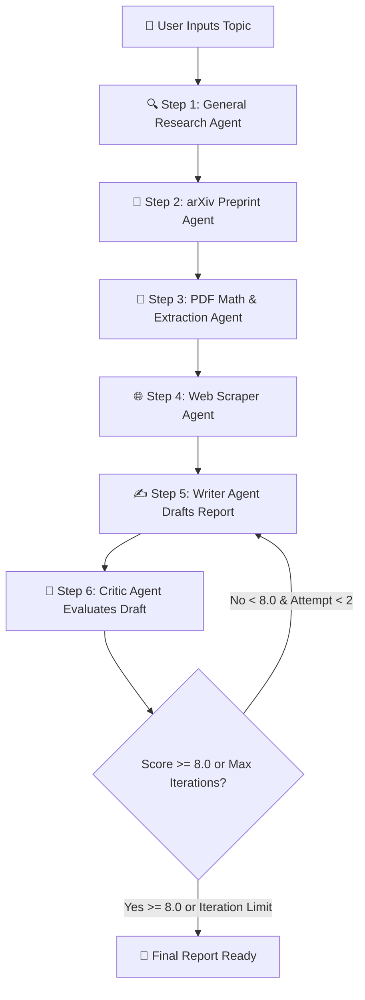

# 🖋️ Multi-Agent AI Deep Researcher

An autonomous, multi-agent research pipeline built using **LangGraph**, **LangChain**, **Streamlit**, **Gemini**, **Tavily**, and **arXiv**. This system coordinates 6 specialized AI agents to perform end-to-end academic research, web scraping, PDF mathematical extraction, draft writing, and self-correcting peer critique.

---

## 📌 Key Features

* **Multi-Agent Collaboration**: Orchestrates specialized agents for research, preprint discovery, PDF reading, web scraping, synthesis writing, and critical evaluation.
* **Autonomous Feedback Loop (LangGraph)**: Evaluates report quality using a **Critic Agent**. If the score is below `8.0/10`, it loops back to the Writer with detailed actionable feedback (up to 2 revision attempts).
* **Deep PDF & Math Extraction**: Extracts formulas, methodologies, and technical proofs from academic arXiv PDFs.
* **Fault-Tolerant Architecture**: Includes built-in fallbacks for all network/API tasks (arXiv rate-limits, PDF parsing errors, web scraping blockages).
* **Interactive Streamlit Dashboard**: 
  * Real-time streaming terminal logs and pipeline progress rail.
  * Search history sidebar with previous reports.
  * Multi-tab viewer for draft reports, critiques, arXiv metadata, and scraped sources.
  * One-click download options for Markdown reports (`.md`) and raw backup data (`.json`).

---

## 🛠️ Project Structure & Tech Stack

### 📂 File Structure
```text
├── agents.py         # Defines LLM agents (Research, arXiv, PDF Reader, Scraper, Writer, Critic)
├── tools.py          # Custom tools for web searching, PDF parsing, and scraping
├── pipeline.py       # LangGraph state graph definition, state schema, and execution loop
├── app.py            # Streamlit UI with threading, live logs, sidebar status rail, & exports
├── requirements.txt  # Dependencies list
└── README.md         # Documentation
```

### 🧰 Tech Stack
* **Orchestration**: `LangGraph`, `LangChain`
* **LLM Engine**: Google Gemini
* **Search & Tools**: Tavily Web Search, arXiv API, PyPDF / PDF Parser
* **Web UI**: Streamlit
* **Language**: Python 3.9+

---

## ⚙️ How It Works (Pipeline Workflow)



### 📝 Step-by-Step Breakdown

1. **Research Agent**: Gathers broad technical facts and initial context on the given topic.
2. **arXiv Agent**: Queries academic repositories to discover preprints and relevant paper URLs.
3. **PDF Reader Agent**: Downloads and parses key paper PDFs to extract equations, proofs, and structural methodologies.
4. **Scraper Reader Agent**: Selects top web resources and scrapes full text for deep implementation specifics.
5. **Writer Chain**: Synthesizes all gathered research (and any previous critique feedback) into a comprehensive Markdown report.
6. **Critic Chain**: Evaluates the drafted report, provides feedback, and assigns a score out of 10.
   * If the **score < 8.0** (and iterations < 2), the workflow loops back to step 5 to refine the draft based on the critique.

---

## 🚀 Getting Started

### 1. Prerequisites
Ensure you have Python 3.9 or higher installed.

### 2. Installation

Clone the repository and enter the directory:
```bash
git clone https://github.com/Dimpal-sahal-05/multi-agent-ai-researcher.git
cd multi-agent-ai-researcher
```

Create and activate a virtual environment:
```bash
# Linux/macOS
python -m venv .venv
source .venv/bin/activate

# Windows
python -m venv .venv
.venv\Scripts\activate
```

Install dependencies:
```bash
pip install -r requirements.txt
```

### 3. Environment Variables
Create a `.env` file in the root directory and add your API keys:
```env
GEMINI_API_KEY=your_google_gemini_api_key
TAVILY_API_KEY=your_tavily_search_api_key
```

### 4. Running the Application

#### Option A: Web Interface (Streamlit)
```bash
streamlit run app.py
```
Open your browser at `http://localhost:8501`.

#### Option B: Terminal / CLI Mode
```bash
python pipeline.py
```

---

## 📊 Outputs & Export Formats

* **Markdown Report (`.md`)**: Fully formatted academic/technical report.
* **JSON Backup (`.json`)**: Contains full execution state including raw research, critique scores, arXiv metadata, and scraped contents.
